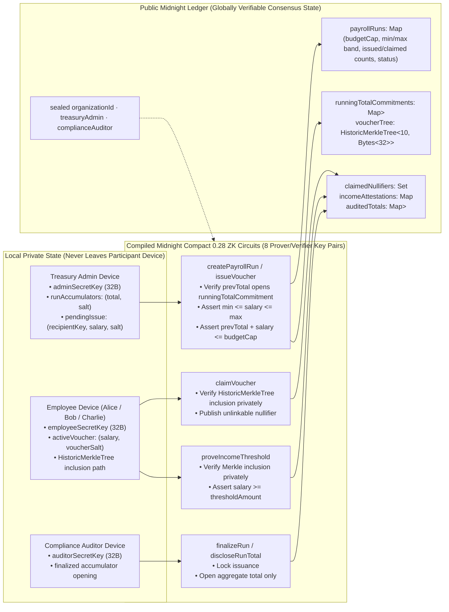

# VeilPay — Shielded Corporate Payroll & Selective-Disclosure Compliance Vault

[](./LICENSE)
[](https://midnight.network/)
[](https://docs.midnight.network/)
[](https://github.com/midnightntwrk)

> **Built for the Midnight Buildathon (Wave 3) on AKINDO** · Recommended GitHub repository topics: `midnightntwrk`, `midnight`, `compact`, `zero-knowledge`, `privacy`

**VeilPay** is a privacy-first corporate & DAO payroll vault built natively on **Midnight Network's dual-ledger architecture**. It solves the fundamental tension between **payroll confidentiality** and **financial/regulatory verifiability**:

- **Zero Salary & Identity Leakage:** Individual employee salaries, employee identities, blinding salts, and even the running cumulative spend stay 100% off-chain in local private state.
- **Zero-Knowledge Policy Enforcement:** Every shielded payroll voucher proves in ZK that (1) the hidden salary sits within the DAO's public compensation band `[minAllocation, maxAllocation]` and (2) the hidden cumulative sum of all vouchers in the run never exceeds `budgetCap`.
- **Unlinkable Shielded Claims:** Vouchers are inserted into an append-only `HistoricMerkleTree<10, Bytes<32>>`. Employees claim by proving Merkle inclusion privately inside ZK and publishing only an unlinkable nullifier—so on-chain observers cannot link claims back to issuance leaves or identities.
- **Two-Tier Programmable Selective Disclosure:**
  1. **Employee Proof of Income (`proveIncomeThreshold`):** An employee proves `salary >= thresholdAmount` to a lender, landlord, or regulator without revealing their exact salary or voucher leaf.
  2. **Auditor Aggregate Spend Disclosure (`discloseRunTotal`):** After a run is finalized, an authorized Compliance Auditor can cryptographically open and publish *only* the aggregate payroll spend while keeping every individual salary 100% private.

---

## Dual-Ledger Architecture



---

## Dual-Ledger State & Privacy Matrix

| Data Field | Location | Visibility | Cryptographic Guarantee |
| :--- | :--- | :--- | :--- |
| `organizationId` | Public Ledger (`sealed`) | Public (immutable) | Set once in `constructor`; binds admin/auditor keys to this org |
| `treasuryAdmin` / `complianceAuditor` | Public Ledger | Public (derived hash) | Witness-derived via `persistentHash([domain, organizationId, sk])` — raw secret keys never leave device |
| `payrollRuns[runId]` | Public Ledger | Public governance bounds | Exposes only `budgetCap`, `minAllocation`, `maxAllocation`, headcount, `issuedCount`, `claimedCount`, `status` |
| `runningTotalCommitments[runId]` | Public Ledger | Opaque 32-byte commitment | `persistentCommit<Uint<64>>(runningTotal, runSalt)` hides cumulative spend while enforcing `sum <= budgetCap` in ZK |
| `voucherTree` | Public Ledger | Opaque 32-byte Merkle leaves | `HistoricMerkleTree<10, Bytes<32>>` of `persistentCommit<VoucherPayload>(..., voucherSalt)` |
| `claimedNullifiers` | Public Ledger | Opaque 32-byte nullifiers | Prevents double-claims; unlinkable to `voucherTree` leaves or employee identities |
| `incomeAttestations` | Public Ledger | Selective Disclosure receipt | Records only `(runId, thresholdAmount, verifierTag)` — exact salary stays hidden |
| `auditedTotals[runId]` | Public Ledger (opt-in) | Selective Aggregate Disclosure | Empty until authorized auditor runs `discloseRunTotal` on a finalized run; individual salaries stay hidden |
| `localSecretKey` | Local Private Witness | **100% Private** | Never disclosed; compiler statically rejects any path reaching ledger |
| `salaryAmount`, `employeePubKey`, `voucherSalt`, `runSalt` | Local Private Witness | **100% Private** | Never disclosed; verified automatically by our byte-level `PrivacyAuditReport` test suite |

---

## Midnight Security & Engineering Highlights

1. **Zero `ownPublicKey()` Authorization Vulnerabilities:** Following Midnight Foundation's late-2026 security guidelines, VeilPay never relies on `ownPublicKey()` for authorization. Every role identity is derived from a local 32-byte secret witness.
2. **Constructor vs. Post-Deployment Domain Separation:** Because a Midnight contract's final address (`kernel.self()`) is derived from its initial state and is not finalized inside `constructor()`, `deriveAdminKey` and `deriveAuditorKey` bind to the sealed `organizationId`, while post-deployment `deriveEmployeeKey`, `deriveNullifier`, and `deriveAttestationId` bind directly to `kernel.self().bytes` for cross-contract replay protection.
3. **Hiding Commitments Defeat Dictionary Attacks:** Individual salaries and cumulative totals are low-entropy `Uint<64>` values. VeilPay uses `persistentCommit` with mandatory fresh non-zero 32-byte salts (enforced in-circuit via `newSalt != prevSalt`) instead of unsalted `persistentHash`.
4. **Concurrent-Safe `HistoricMerkleTree<10, Bytes<32>>`:** Using Midnight's historic Merkle tree ensures employee claims and income threshold proofs remain valid even if new vouchers are appended in concurrent blocks.
5. **Automated Byte-Level Privacy Leak Auditing:** Both our Vitest suite and the live web UI include a recursive public-ledger scanner (`src/midnight/privacy.ts`) that inspects every raw byte array and scalar in the decoded Midnight ledger to verify `0` secret leaks after every state transition.

---

## Repository Structure

```text
.
├── contract/
│   ├── veilpay.compact              # Compact 0.28 ZK smart contract (8 impure + 7 pure circuits)
│   ├── witnesses.ts                 # Browser- & Node-compatible TypeScript witnesses
│   └── managed/veilpay/contract/    # Compiled Compact JS + TypeScript bindings (runtime 0.21.0)
├── scripts/
│   └── compile-compact.mjs          # Cross-platform compiler runner (compactc / compact CLI)
├── src/
│   ├── midnight/
│   │   ├── sim.ts                   # In-memory Midnight CompactSimulator (compact-runtime 0.21.0)
│   │   ├── engine.ts                # Multi-actor dual-ledger orchestrator (Admin/Employees/Auditor)
│   │   ├── privacy.ts               # Recursive public-ledger privacy leak auditor
│   │   └── lace.ts                  # Midnight Lace DApp Connector API v4 integration
│   ├── components/
│   │   └── LaceWalletModal.tsx      # Lace wallet detection & network selector modal
│   ├── test/
│   │   ├── veilpay.sim.test.ts      # Full lifecycle, ZK constraints & privacy invariant tests
│   │   └── security-and-lace.test.ts# Guardrails, cross-run isolation, scanner & Lace v4 tests
│   ├── App.tsx                      # Interactive Dual-Ledger X-Ray Web Console
│   └── index.css                    # Midnight dark-mode styling
├── PITCH_DECK.md                    # 10-slide presentation deck for judges
├── DEMO_VIDEO_SCRIPT.md             # Exact 2-minute walkthrough script
├── LICENSE                          # Apache License 2.0
├── package.json
├── vite.config.ts
└── vitest.config.ts
```

---

## Quick Start & Reproducible Verification

### Prerequisites

- **Node.js** `>= 22.0.0` and **pnpm** `>= 10`
- **Midnight Compact Compiler** (`compactc 0.36.1` / `compact 0.5.3`, Language `0.28.0`) — required only to recompile `contract/veilpay.compact`; compiled TypeScript/JS contract bindings are included so `pnpm test` and `pnpm dev` work immediately after install.

Install Compact CLI (optional for recompiling from source):
```bash
curl --proto '=https' --tlsv1.2 -LsSf https://github.com/midnightntwrk/compact/releases/latest/download/compact-installer.sh | sh
compact update 0.36.1
```

### 1. Install Dependencies

```bash
pnpm install
```

### 2. Compile the Compact ZK Contract (Full Proving & Verifying Keys)

```bash
pnpm run compile
```
Generates all 8 ZKIR circuits (`contract/managed/veilpay/zkir/*.{zkir,bzkir}`), 8 proving/verifying key pairs (`contract/managed/veilpay/keys/*.{prover,verifier}`), and typed JS/TS bindings (`contract/managed/veilpay/contract/index.{js,d.ts}`):
- `createPayrollRun`
- `issueVoucher`
- `claimVoucher`
- `proveIncomeThreshold`
- `finalizeRun`
- `discloseRunTotal`
- `rotateAdmin`
- `setComplianceAuditor`

For fast TypeScript-only iteration without regenerating `.prover` keys:
```bash
pnpm run compile:fast
```

### 3. Run Typecheck & Automated Simulator + Privacy Test Suite

```bash
pnpm run typecheck
pnpm test
```

Verified test output (`14/14` passing across `2` test suites):
- `src/test/veilpay.sim.test.ts` (**8 tests**): deployment & sealed org ID, end-to-end 3-employee shielded payroll lifecycle, hidden cumulative budget-cap overflow rejection, min/max band & headcount & fresh-salt guards, unlinkable Merkle claim + double-claim nullifier rejection + forged/stolen claim rejection, false income threshold rejection, tampered aggregate audit rejection + RBAC + admin rotation, concurrent `HistoricMerkleTree` insertion safety.
- `src/test/security-and-lace.test.ts` (**6 tests**): zero-key & invalid-parameter guards, multi-run isolation & cross-run voucher replay rejection, `pureCircuits` domain-separation non-collision, positive privacy-scanner leak detection self-test, Midnight Lace DApp Connector API v4 detection/connection test, and UI adversarial rejection helper verification on both fresh and partially spent runs.

### 4. Launch the Interactive Dual-Ledger Web Console

```bash
pnpm dev
```
Or build for production:
```bash
pnpm run build
pnpm run preview
```

### 60-Second Judge Walkthrough in the Web UI

1. Open the app (`pnpm dev`) — the real compiled `veilpay.compact` contract automatically boots inside the browser via `@midnight-ntwrk/compact-runtime@0.21.0` + WASM `@midnightntwrk/onchain-runtime-v4`.
2. Click **Load Q4 Demo** in the top bar: deploys Run #1 (`$35,000` cap, `$4,000–$18,000` band) and issues 3 shielded vouchers (`Alice $12,750`, `Bob $9,400`, `Charlie $6,850`).
3. Inspect the **Public Midnight Ledger** (right panel) and the **Live Privacy Invariant Audit** banner: `0 secrets leaked` — individual salaries and the `$29,000` spend never appear on chain.
4. On **Alice Chen**'s device (left panel):
   - Click **Claim Shielded Voucher** -> executes `claimVoucher()` with a real `HistoricMerkleTree` proof and publishes an unlinkable nullifier.
   - Click **Test Double-Claim Replay** -> watch the circuit reject replay via `claimedNullifiers`.
   - Click **Generate ZK Income Proof** (`>= $10,000` for `MetroBank-Mortgage-2026`) -> watch the attestation appear on the public ledger while Alice's exact `$12,750` salary stays hidden!
   - Click **Test False Threshold (+$5k Reject)** -> watch the ZK range check reject an overstated income claim.
5. Switch to **Treasury Admin** -> click **Finalize Run #1** -> switch to **Compliance Auditor** -> click **Test Tampered Total (-$1 Reject)**, then **Verify & Disclose Aggregate Total** to publish `$29,000` while individual salaries stay 100% shielded!
6. Click **Connect Lace Wallet** to test live `window.midnight.mnLace` detection & `preprod`/`preview`/`undeployed` connection via `@midnight-ntwrk/dapp-connector-api@4.1.0`.

---

## Wave 3 Progress & Wave 4 Roadmap

### Delivered in Wave 3
- Complete 8-circuit Compact 0.28 smart contract compiled with `compactc 0.36.1` (full ZKIR + prover/verifier keys).
- Browser- & Node-unified witness engine and in-memory Midnight `CompactSimulator`.
- 14 passing automated simulation, adversarial security, privacy leak audit, and Lace v4 tests.
- Full-stack Dual-Ledger X-Ray React/Vite UI with real in-browser WASM Compact execution and Lace wallet integration.

### Planned for Wave 4
- Native Midnight shielded token settlement (`receiveShielded` / `sendShielded`) directly paired with `claimVoucher` on Preprod/Preview Testnet.
- Encrypted off-chain voucher inbox (X25519 envelope encryption of `(amount, voucherSalt)` to each employee's encryption public key).
- Multi-signature Treasury Admin threshold approvals and CSV batch payroll import for DAO finance teams.

---

## Attribution & License

- Built for the **Midnight Network** ecosystem (`midnightntwrk`) using the Compact 0.28 toolchain (`compactc 0.36.1`), `@midnight-ntwrk/compact-runtime@0.21.0`, and `@midnight-ntwrk/dapp-connector-api@4.1.0`.
- Licensed under the **Apache License 2.0** — see [LICENSE](./LICENSE).
